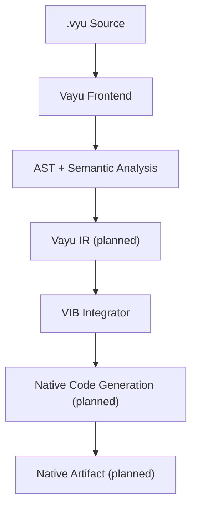

<div align="center">

<a href="https://vayu.gt.tc">
  
</a>

# Vayu

### Python simplicity. Native performance. Low-level control. AI-ready.

**A modern general-purpose programming language designed to combine simplicity, performance, portability, and powerful application development.**

<p>
  <a href="https://vayu.gt.tc"></a>
  <a href="https://vayu.gt.tc/faq"></a>
  <a href="docs/syntax.md"></a>
  <a href="https://vayu.gt.tc/speed"></a>
  <a href="https://marketplace.visualstudio.com/items?itemName=Fliczo.vayu"></a>
</p>

<p>
  
  
  
  
</p>

</div>

---

<div align="center">

<a href="https://vayu.gt.tc">
  
</a>

</div>

<div align="center">

## ⚡ Write Simple. Run Native. Control Everything.

**Vayu** brings together Python-inspired readability, native-performance goals, low-level control, modern typing, AI/ML ambitions, and application-development capabilities in one language.

**[🌐 Official Website](https://vayu.gt.tc) · [📖 Syntax](docs/syntax.md) · [🤖 AI & ML](docs/ai.md) · [📦 Packages](docs/package.md) · [🧭 Roadmap](Roadmap.md) · [📊 Benchmarks](https://vayu.gt.tc) · [🧩 VS Code](https://marketplace.visualstudio.com/items?itemName=Fliczo.vayu)**

</div>

---

## 🌐 Website

**[Visit the official Vayu website →](https://vayu.gt.tc)**

The website is the primary place for the latest Vayu information, roadmap, syntax references, benchmark information, and project updates. The Vayu logo and the banner links at the top of this README are clickable and lead directly to the website.

---

## 📊 Benchmarks

Vayu includes benchmarking as part of its development and performance evaluation process. Benchmarks are used to track compiler/runtime progress and compare representative workloads as the implementation evolves.

**[→ View the Vayu website and current benchmark information](https://vayu.gt.tc/)**

> Benchmark numbers are implementation- and environment-dependent. The website should be treated as the current source for published benchmark results rather than treating README numbers as permanent guarantees.

---

## 🧩 Editor Support

Vayu has editor tooling for `.vyu` source files through the VS Code extension and a native Visual Studio Community TextMate/VSIX extension.

**[🛒 Install Vayu from the VS Code Marketplace](https://marketplace.visualstudio.com/items?itemName=Fliczo.vayu)**

**Visual Studio Community:** build `vscommunity-vayu-Extention` with its `build.ps1` script and install the generated `vayu-lang-support-1.0.0.vsix`.

**[⚡ Install directly in VS Code](vscode:extension/Fliczo.vayu)**

The extension provides editor-side integration for Vayu, including:

- `.vyu` language support
- Syntax highlighting
- Vayu Language Server integration
- Diagnostics
- Hover information
- Go to definition
- Completion
- References
- Rename support
- Signature help
- Formatter integration
- Linter integration
- Vayu configuration support

The compiler repository also contains the standalone `vls`, `vfmt`, and `vlint` tooling used by the extension.

---

## What is Vayu?

**Vayu** is a next-generation programming language designed to combine the best ideas from:

- 🐍 **Python** -- simple, readable syntax and a powerful ecosystem
- ⚡ **C++** -- native performance and low-level control
- ☕ **Java** -- portability and large-scale application development
- 🎯 **C#** -- modern application and GUI development

Vayu aims to provide these capabilities without forcing developers to switch between multiple languages for different types of software.

> **Write simple. Run native. Control everything.**

---

## Core Philosophy

Vayu is built around a simple idea:

> **Programming should be easy to learn, powerful enough for professionals, and fast enough for demanding software.**

The language focuses on:

- Clean, Python-inspired syntax
- Native compiled execution
- Strong static typing with type inference
- Optional explicit type annotations
- Modern memory and resource management
- High-level APIs with low-level access when required
- AI/ML and scientific computing
- GUI and application development
- Game and graphics development
- Systems and performance-oriented programming
- Cross-platform development
- Vayu-native APIs and runtime

---

# Key Features

## 🧠 Simple Syntax

Vayu uses a clean, indentation-friendly syntax designed to remain readable while supporting serious software development.

The complete syntax and currently implemented features are documented separately:

**[→ Read the Vayu Syntax Reference](docs/syntax.md)**

---

## ⚡ Native Performance

Vayu is designed as a **compiled native language**.

The goal is to provide:

- Native machine-code execution
- Compiler optimizations
- Efficient memory usage
- Hardware-level control
- Low runtime overhead
- High-performance applications

---

## 🔄 Vayu + VIB Integrator Data Flow

Vayu is moving its native compiler into **VIB (Vayu Integration Backend)**, the integrated toolchain implementing the Integrator architecture. VIB will own the Vayu IR, verification, native code generation, runtime integration, optional platform-linker adapter, cache, incremental compilation, and execution dispatch. It is not a separate required executable.



**[→ VIB Architecture](docs/vib.md) · [→ Complete VIB Technical Documentation](docs/vib-documentation.md) · [→ Full Roadmap](Roadmap.md)**

> Transition status: the old external-backend lowering/invocation has been removed from the active native compiler source. VIB native code generation is not implemented yet; use `--run` or `--vm` for execution until the roadmap's native conformance gates pass.

## 🧰 Windows Toolchain and Runtime Layout

The Windows development layout contains Vayu-source utilities, optional platform tools, and example-generation helpers. The table below lists expected roles, not a guarantee that every optional binary is included in the repository.

| Path | Purpose |
|---|---|
| `tools/lld-link.exe` | optional COFF linker for future VIB object-linking support |
| `tools/ld.lld.exe` | optional ELF linker for future VIB object-linking support |
| `tools/kernel32.lib` | Optional Windows import library for a future VIB PE-link configuration |
| `tools/nva.vyu` | Vayu-source package manager |
| `tools/nva-server.vyu` | Reference read-only NVA registry server |
| `tools/make_tiny_onnx.py` | Generates `examples/assets/tiny_mlp.onnx` for AI/ML examples |
| `tools/vcruntime140.dll`, `tools/vcruntime140_1.dll` | Microsoft C runtime dependencies for the bundled runtime |

Platform linkers may be used later through a VIB-owned adapter, but they are not a substitute for Vayu-owned code generation. Check the actual repository/distribution before assuming any optional tool is present. See [Third-party software and files](Third_Party.md) for provenance and redistribution checks.

For the file-by-file layout, build expectations, and local verification commands, see [tools/README.md](tools/README.md).

---

## 🧩 Modern Type System

Vayu combines:

- Static typing
- Type inference
- Optional type annotations
- Generic types
- Structs
- Classes
- Inheritance
- Function types
- Modern error handling

---

## 🧠 Memory & Resource Control

Vayu is designed to provide both convenience and control.

The language aims to support:

- Automatic management for common cases
- Deterministic resource handling
- Ownership-oriented programming
- Smart pointers
- Explicit memory operations
- Unsafe/low-level programming when required

Planned smart-pointer concepts include:

```text
unique<T>
shared<T>
weak<T>
```

---

# 🤖 AI & Machine Learning

AI is a major direction of Vayu.

The ecosystem is planned to support:

- Machine learning
- Deep learning
- Neural networks
- Tensor operations
- Data processing
- Computer vision
- GPU acceleration
- CUDA
- ONNX
- Vayu-native AI/ML APIs as they are implemented

Vayu will expose AI/ML capabilities through native Vayu APIs as those features are implemented. Libraries from foreign-language ecosystems are not automatically supported.

**[→ Read the Vayu AI & ML Documentation](docs/ai.md)**

---

# 📦 Package Ecosystem

Vayu is designed around a dedicated package ecosystem.

The package manager is planned around:

```text
nva install <package>
```

The ecosystem is intended to provide:

- Package installation
- Dependency management
- Version management
- Project configuration
- Lock files
- Package publishing
- Build integration
- Native libraries
- AI/ML packages
- GUI libraries
- Game-development libraries

The package documentation contains the detailed package-system specification:

**[→ Read the Vayu Package Documentation](docs/package.md)**

> Package-manager naming and implementation may evolve as the ecosystem matures.

---

# 🖥️ Application Development

Vayu is designed to cover more than command-line programs.

### GUI

- Desktop applications
- Modern user interfaces
- Native application APIs
- Cross-platform GUI development

### Games

- Game logic
- Graphics
- Input
- Audio
- Physics
- Rendering
- OpenGL
- Vulkan
- DirectX

### Systems

- Native applications
- System utilities
- Hardware-oriented software
- High-performance services
- Networking

### Scientific & Data

- Numerical computing
- Data processing
- Scientific applications
- Visualization
- AI/ML workflows

---

# 🔗 Language and Runtime Boundary

Vayu is its own programming language with `.vyu` source files, its own frontend, semantics, runtime, and compiler toolchain. Python-inspired syntax is a design influence only. Vayu does not currently provide Python, Java, .NET, or other foreign-language source/runtime compatibility. Native system-library interfaces, where explicitly implemented, are low-level platform interfaces and do not make those languages supported by Vayu.

---

# 🌍 Cross-Platform

Vayu is designed to become a cross-platform language.

Target platforms include:

- Windows
- Linux
- macOS
- Android
- Other platforms as the compiler and ecosystem mature

---

# 📁 Source Format

Vayu source files use:

```text
.vyu
```

Examples:

```text
hello.vyu
main.vyu
game.vyu
ai.vyu
```

The official language name is **Vayu** and the official source extension is **`.vyu`**.

---

# 📚 Documentation

| Document | Purpose |
|---|---|
| [`docs/syntax.md`](docs/syntax.md) | Complete language syntax and implemented features |
| [`docs/package.md`](docs/package.md) | Package manager and ecosystem |
| [`docs/ai.md`](docs/ai.md) | AI/ML direction and ecosystem |
| [`Roadmap.md`](Roadmap.md) | Long-term vision, phased roadmap, and current development status |
| [`CODE OF CONDUCT.md`](CODE%20OF%20CONDUCT.md) | Community standards and contributor conduct |
| [`REPORTING_GUIDELINES.md`](REPORTING_GUIDELINES.md) | Guidelines for reporting and handling unacceptable behavior |

---

# 🚀 Long-Term Vision

Vayu is intended to grow into a complete development ecosystem.

The long-term vision includes:

- Mature native compiler
- Advanced optimizer
- Self-hosting compiler
- Standard library
- Package ecosystem
- IDE/LSP support
- VS Code extension, formatter and linter
- Debugging tools
- AI/ML stack
- GUI framework
- Game-development stack
- Graphics APIs
- Native interoperability
- Cross-platform tooling
- Modern concurrency
- Metaprogramming
- Professional developer tooling

**[→ Read the Vayu Vision](Roadmap.md)**

---

# 👨‍💻 Independent Development

Vayu is currently being developed by **one independent developer**.

There is:

- No company behind the project
- No corporate development team
- No revenue model
- No large development budget
- No large engineering organization

Vayu is being developed as an independent project driven by experimentation, learning, engineering, and the goal of creating a language that combines ideas from several ecosystems.

> **Small team. Big vision.**

---

# 🤝 Contributing

Contributions, ideas, bug reports, documentation improvements, and language-design discussions are welcome.

Before contributing, please read **[CODE OF CONDUCT.md](CODE%20OF%20CONDUCT.md)** and follow the project's community standards.

---

# ✅ Advantages

- Python-inspired readability
- Native compiled execution
- Low-level capabilities
- Static typing with inference
- Modern memory-management direction
- AI/ML-focused ecosystem
- GUI development goals
- Game-development goals
- Systems-programming capabilities
- Cross-platform ambitions
- Vayu-native runtime and library development
- Beginner-friendly philosophy
- Professional-development ambitions
- One unified ecosystem instead of many disconnected languages

---

# ⚠️ Current Limitations

Vayu is still an evolving language.

Important limitations include:

- Small ecosystem
- Limited third-party packages
- Young compiler
- Developing tooling
- IDE support is currently centered on Visual Studio Code
- Advanced IDE integrations and debugger tooling are still evolving
- Limited documentation compared with established languages
- Smaller community
- Many planned features are not yet mature
- Compatibility layers are still evolving
- Performance and stability will improve as the compiler matures

Vayu should therefore be considered an **early-stage independent language project**, not a replacement for mature languages yet.

---

# 🎯 Who Is Vayu For?

Vayu is designed for developers who want to work across multiple areas without constantly changing languages.

Potential users include:

- Beginners learning programming
- Application developers
- Systems programmers
- Game developers
- AI/ML developers
- Scientific programmers
- Tool developers
- Desktop application developers
- Performance-oriented developers
- Developers coming from Python
- Developers coming from C++
- Developers interested in language design

---

# 🧭 Design Principles

### 1. Simplicity
Common tasks should require minimal unnecessary code.

### 2. Performance
High-level syntax should not automatically mean low performance.

### 3. Control
Developers should be able to access lower-level capabilities when needed.

### 4. Interoperability
Existing ecosystems should be usable rather than discarded.

### 5. Portability
Software should be able to move across platforms with minimal changes.

### 6. Practicality
Features should solve real development problems rather than exist only because they are technically possible.

### 7. One Ecosystem
The goal is to make Vayu useful for small programs, applications, games, AI systems, and native software through Vayu-native language and library support.

---

# 📊 Current Status

Vayu has an expanding language frontend, interpreter, bytecode compiler/VM, runtime integrations, package tooling, and editor tooling. The native compiler is transitioning to **VIB (Vayu Integration Backend)**, which implements the Integrator architecture inside this repository.

The legacy external-backend lowering and invocation have been removed from the active native compiler source. The VIB native code generator and verified IR are not implemented yet, so `--native` and `--native-out` report this transition state instead of invoking an external backend. Use `--run` or `--vm` for execution.

Current language and runtime features remain subject to execution-mode coverage. Native support must be re-established feature-by-feature through the shared conformance suite rather than inferred from interpreter support.

**Engineering roadmap:** [Roadmap.md](Roadmap.md)  
**VIB architecture:** [docs/vib.md](docs/vib.md)  
**VIB implementation:** [VIB/README.md](VIB/README.md)  
**Benchmark predictions:** [VIB/docs/BENCHMARK_PREDICTIONS.md](VIB/docs/BENCHMARK_PREDICTIONS.md)

The roadmap maps the historical language/tooling phases to the new VIB implementation phases. Performance expectations, including comparisons with JIT compilers, are hypotheses until measured reproducibly.

---

## DeepSeek

<div align="center">
<a href="https://www.deepseek.com/">

</a>
</div>

**DeepSeek played the larger supporting role in the development process.**

It provided substantial assistance with:

- Programming
- Compiler development
- Architecture discussions
- Debugging
- Language design
- Implementation planning
- Turning concepts into practical code
- Exploring solutions during development

**Thank you, DeepSeek, for being a major part of the Vayu journey. ❤️**

---

## ChatGPT

<div align="center">

<a href="https://chatgpt.com/">

</a>

</div>

**ChatGPT provided a smaller supporting role**, mainly helping with:

- Confirmation
- Design discussions
- Brainstorming
- Documentation refinement
- Reviewing ideas
- Clarifying technical concepts

**Thank you, ChatGPT, for being part of the Vayu journey. ❤️**

---

> **Acknowledgement of these tools does not imply sponsorship, partnership, endorsement, or official affiliation with Vayu or its developer.**

---

# 💭 Final Words

Vayu is an ambitious independent experiment:

**What if a readable syntax, native execution, and low-level control could be combined in one purpose-built language?**

Vayu is an attempt to explore that idea.

It is still young.

It is still evolving.

And there is a long way to go.

But the goal is simple:

> **Make programming simpler without giving up power.**

---

<div align="center">

### Vayu

**Write simple. Run native. Control everything.**

Made independently with ❤️, code, experimentation, and a lot of debugging.

**[🌐 vayu.gt.tc](https://vayu.gt.tc)**

</div>


## Project policies

- [Contributing](CONTRIBUTING.md)
- [Code of Conduct](CODE_OF_CONDUCT.md)
- [Security](SECURITY.md)
- [Support](SUPPORT.md)
- [Citation](CITATION.cff)
- [Governance](GOVERNANCE.md)
- [License](LICENSE)
